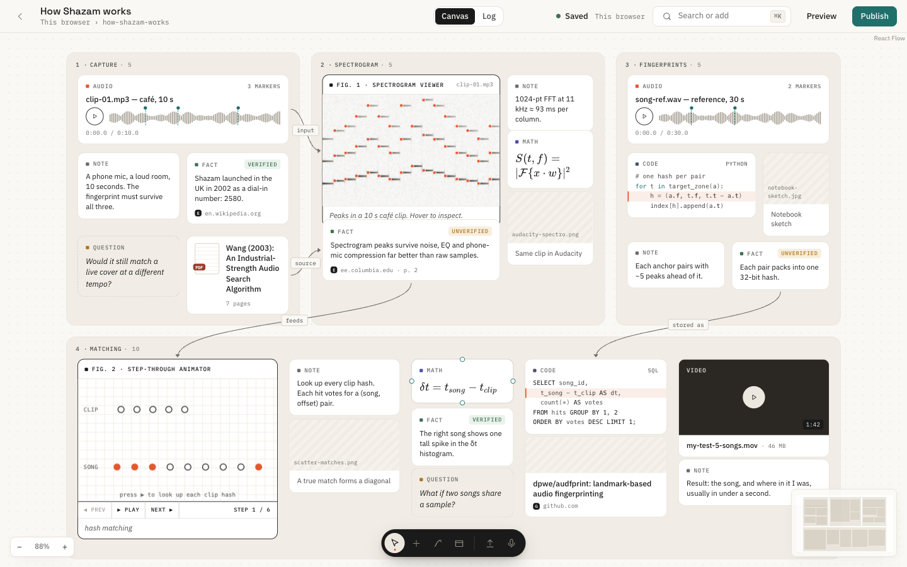

# Specimen

Specimen is a research board for one topic at a time. You paste notes, sources, photos, audio and code onto a canvas. You connect the items that relate. Then you publish the board as a calm, illustrated page that readers can read and play with.

**Use it:** <https://maskmanlucifer.github.io/specimen/app/> · **About:** <https://maskmanlucifer.github.io/specimen/>



- **No server.** Specimen is a static web app. It runs fully in your browser.
- **Your storage.** Boards live in this browser (IndexedDB), or in your own Google Drive.
- **Open format.** A board is a plain folder: `board.json` and a `media/` folder. Any tool can read it.
- **Publish anywhere.** Share a public link, or download a static site for any web host.

## Two ways to keep boards

| | This browser | Google Drive |
|---|---|---|
| Account | None | Sign in with Google |
| Where boards live | IndexedDB on this device | `My Drive/Specimen/` |
| Other devices | No (export and import a .zip) | Yes |
| Share links | No (download a static site) | Yes |
| What Specimen can see | Only this browser's data | Only the files that Specimen creates (`drive.file`) |

Google sign-in runs through [Supabase](https://supabase.com). A small Edge Function (`supabase/functions/drive-token`) keeps the Google refresh token, encrypted, so the browser gets fresh Drive access without a new sign-in every hour. The hosted copy uses our Supabase project. You can connect your own project in **Settings → Storage**: see the [cloud setup guide](docs/cloud-setup.md).

Without an account, all data stays in this browser. The dashboard and Settings show a backup reminder, **Export all** (one .zip), import, and **Clear this browser**.

## Develop

You need Node.js 22 or later and pnpm.

```sh
pnpm install
pnpm dev            # the app on http://localhost:5173
pnpm build          # the reader bundle and the web app (apps/web/dist)
pnpm test
pnpm typecheck
```

The app works without any settings: it starts in "This browser" mode. To turn on Google Drive, create `apps/web/.env.local` (git ignores it) with your own public values:

```sh
VITE_SUPABASE_URL=https://<project-ref>.supabase.co
VITE_SUPABASE_ANON_KEY=<publishable key>
VITE_GOOGLE_API_KEY=<API key for public share links>   # optional
```

These values are public by design. Secrets (the Google client secret and the token key) live only in the Supabase project.

## Deploy

```sh
pnpm deploy         # builds, then pushes the site to the gh-pages branch
```

| Path | Content |
|---|---|
| `/specimen/` | The home page, privacy and terms (`site/`) |
| `/specimen/app/` | The app (`apps/web`) |

The build reads the `VITE_…` values from `apps/web/.env.local`.

## Repository layout

| Path | Content |
|---|---|
| `apps/web` | The app (React and Vite): dashboard, board editor, publish, plugins and settings. `src/backend/` holds storage (IndexedDB and Drive), boards, import, plugins and publishing. |
| `packages/schema` | The board format (zod), the plugin manifest and the story builder. |
| `packages/story` | The published reader (React), the plugin sandbox and shared render parts. It also builds `reader.js` for static sites. |
| `plugins/` | Built-in figure plugins. Each one is a plain folder. |
| `supabase/` | The token table migration and the `drive-token` Edge Function. |
| `site/` | The static home, privacy and terms pages. |
| `docs/` | Guides. |

## Guides

- [Cloud setup: Google Drive through your own Supabase](docs/cloud-setup.md)
- [Publishing, and adding a board to your own site](docs/publishing.md)
- [Making a plugin](docs/plugins.md)
- [The board format](docs/board-format.md)

The last version with a Node server and more storage types (S3, Dropbox, WebDAV and others) is tagged `v0.1-server`.

## License

MIT. Built by [Maskman Lucifer](https://github.com/maskmanlucifer).
